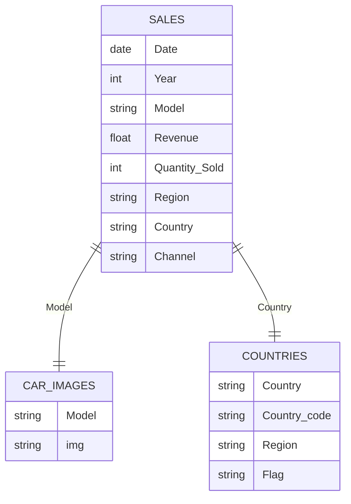

<div align="center">

# 🚗 Mercedes-Benz Sales Analytics Dashboard

### 📊 An Interactive Power BI Report for Global Sales Performance

[](https://powerbi.microsoft.com/)
[](https://en.wikipedia.org/wiki/Comma-separated_values)
[](https://opensource.org/licenses/MIT)

**A comprehensive analysis of Mercedes-Benz sales data (2019–2023) covering revenue, models, regions, and channels.**

[Overview](#-overview) • [Dashboard](#-dashboard) • [Key Insights](#-key-insights) • [Data Model](#-data-model) • [Contact](#-contact)

</div>

---

## 📖 Overview

This project delivers an interactive **Power BI dashboard** built on a detailed Mercedes-Benz sales dataset spanning **5 years (2019–2023)**.

The report provides executive-level insights into sales performance, regional distribution, model popularity, and revenue trends — enabling data-driven decisions across marketing, sales, and supply chain teams.

| 🎯 Goal | ✅ Result |
|:--------|:---------|
| Track global sales performance | Interactive multi-page dashboard |
| Identify top-performing models | Model-level revenue breakdown |
| Analyze regional & channel trends | Geospatial + channel analysis |
| Monitor year-over-year growth | 5-year trend visualization |

---

## 📊 Dashboard

The Power BI report is structured into **4 interactive pages**, each focused on a specific business question.

### 📄 Report Structure

| Page | Purpose |
|:-----|:--------|
| 📈 **Executive Overview** | High-level KPIs: Revenue, Units Sold, YoY Growth |
| 🚗 **Model Performance** | Top-selling models & revenue contribution |
| 🌍 **Regional Analysis** | Revenue by Region, Country, and Channel |
| 📅 **Time Series Trends** | Monthly & yearly sales patterns |

### 🔢 Headline Metrics

| KPI | Value |
|:----|:------|
| 💰 **Total Revenue** | ~$200M+ |
| 📦 **Total Units Sold** | 1,500+ |
| 🌍 **Countries Covered** | 20+ |
| 🚗 **Car Models** | 25+ |
| 📅 **Time Period** | 2019 – 2023 |

> *Values are approximate based on the dataset provided.*

---

## 💡 Key Insights

> **1.** 🏆 **Revenue Concentration:** The top 5 car models account for a significant share of total revenue, with the **AMG GT 4-Door Coupe** and **S-Class** consistently leading.

> **2.** 🌍 **Regional Dominance:** **North America** and **Europe** are the largest markets, with the **United States**, **Canada**, and **Germany** contributing the highest revenue.

> **3.** 📅 **Yearly Growth:** Sales show a clear upward trend from **2019 to 2023**, with **2023** being the strongest year.

> **4.** 🏪 **Channel Mix:** **Wholesale** dominates over **Dealership** and **Online** channels, indicating a B2B-heavy sales model.

> **5.** 🌱 **EV Momentum:** Models like **EQB**, **EQA**, and **EQE SUV** show increasing sales, reflecting the shift toward electrification.

---

## 🗂️ Data Model

### 📁 Source Files

| File | Description |
|:-----|:------------|
| `Mercedes_Sales_Data.csv` | Raw transactional sales data (2019–2023) |
| `Car Images.csv` | Image URLs mapped to each car model |
| `Countries with Flags URL.csv` | Country metadata: code, region, and flag URL |

### 🔗 Data Relationships



### 📋 Data Fields

| Field | Type | Description |
|:------|:-----|:------------|
| `Date` | Date | Transaction date |
| `Year` | Integer | Year of sale |
| `Model` | Text | Mercedes-Benz model name |
| `Revenue` | Decimal | Sale amount in USD |
| `Quantity Sold` | Integer | Number of units |
| `Region` | Text | Continent (Africa, Asia, Europe, etc.) |
| `Country` | Text | Country of sale |
| `Channel` | Text | Sales channel (Wholesale, Dealership, Online) |

---

## 🎨 Dashboard Features

| Feature | Description |
|:--------|:------------|
| 🔍 **Interactive Filters** | Slice by Year, Region, Model, and Channel |
| 🖼️ **Dynamic Car Images** | Model images from `Car Images.csv` |
| 🚩 **Country Flags** | Flag icons from `Countries with Flags URL.csv` |
| 📈 **KPI Cards** | Total Revenue, Units, YoY Growth |
| 📊 **Visualizations** | Bar charts, line charts, maps, treemaps |

---

## 🧰 Technology Stack

<div align="center">


</div>

| Component | Technology |
|:----------|:-----------|
| Data Source | CSV files |
| Data Transformation | Power Query (M) |
| Calculations | DAX |
| Visualization | Power BI Desktop |
| Report Sharing | Power BI Service |

---

## 📂 Repository Structure

```text
📦 Mercedes-Benz-Sales-2019-2023/
 ┣ 📂 Dataset/
 ┃ ┣ 📄 Mercedes_Sales_Data.csv
 ┃ ┣ 📄 Car Images.csv
 ┃ ┗ 📄 Countries with Flags URL.csv
 ┣ 📊 Mercedes_Sales_Dashboard.pbix
 ┣ 📽️ Mercedes_Sales_Presentation.pptx
 ┗ 📜 README.md
```

---

## 🚀 How to Use

### 1. Clone the Repository
```bash
git clone https://github.com/abdallamohamed8354/Mercedes-Sales-Analytics.git
cd Mercedes-Sales-Analytics
```

### 2. Open the Dashboard
- Open `Mercedes_Sales_Dashboard.pbix` in **Power BI Desktop**.
- Click **Refresh** to reload the CSV data.

### 3. Explore the Report
- Use slicers to filter by **Year**, **Region**, **Model**, or **Channel**.
- Hover over visuals to see detailed tooltips.
- Navigate between the 4 report pages for different perspectives.

---

## 🎯 Business Recommendations

| Priority | Action |
|:---------|:-------|
| 🏆 **Focus** | Prioritize top-performing models (AMG GT, S-Class) in marketing |
| 🌍 **Expand** | Invest in underperforming regions with growth potential |
| 🌱 **Electrify** | Accelerate EV (EQ) lineup promotion |
| 🏪 **Optimize** | Balance Wholesale vs. Dealership channel strategy |

---

## 🤝 Contributing

Contributions are welcome! Feel free to:

1. 🍴 Fork the repository
2. 🌿 Create a feature branch
3. 💾 Commit your changes
4. 🚀 Push and open a Pull Request

---

## 📜 License

This project is licensed under the **MIT License** — free to use and modify.

---

## 📧 Contact

<div align="center">

**Abdalla Mohamed**

[](mailto:abdallamohamed8354@gmail.com)
[](https://linkedin.com/in/abdalla-mohamed-farouk)
[](https://github.com/Abdalla820)

</div>

---

<div align="center">

### ⭐ If you found this project useful, please give it a star!

**Made with ❤️ by Abdalla Mohamed using Power BI**

</div>
